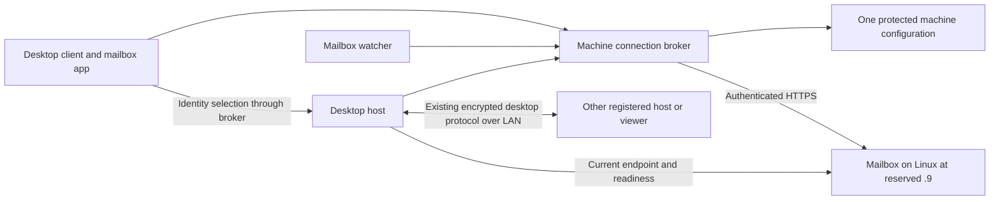

# LAN registration and recovery

Design baseline: 2026-11-08. Approved scope: local Wi-Fi, existing RustDesk engine and mailbox. No Tailscale, mesh provider, relay deployment, router port forwarding, UPnP, public service, or replacement desktop engine. This document supersedes earlier mesh proposals and the prohibition on address-change monitoring; it does not restore network-triggered session invalidation. The user still excludes deliberate disruption of the live Wi-Fi for testing.

Implementation backlog and ownership: [LAN stories](LAN-STORIES.md). Rollout: [migration and coordination](LAN-ROLLOUT.md). This is a build specification, not a claim that these features are installed. `bb58ac5c4` already provides a 15-second host address poll, 30-second client refresh and one pre-handshake lookup retry; OS notifications, shared configuration, presence and migration remain work.

## User experience

New machine: install Remote Desktop Client, Remote Desktop Service, or both; approve registration; choose a friendly alias; complete required OS permissions; see a verified setup result. Existing mailbox identity is reused. A genuinely new machine receives an identity only after authorized approval. Windows elevation and Mac Accessibility/Screen Recording approval remain explicit local OS steps. We cannot promise a silent Mac setup or one click including OS approvals.

Existing machine: installer offers **Upgrade this machine**. It preserves identity, signing key, credentials, alias, watcher cursor/pending work and history. No account reset, token deletion or re-enrollment is the recovery strategy.

Connecting: select an alias, then Connect. The alias maps to immutable machine identity, never to a cached IP or a RustDesk self-reported ID. The service resolves the current endpoint immediately before connecting and performs the existing encrypted-channel proof and mailbox grant exchange. Any authenticated mailbox identity may connect to any enrolled hosting-enabled machine; mesh membership and network names are not credentials.

## Components and boundaries

The Linux mailbox stays at reserved `192.168.1.9:42819`. The Linux service and Mac desktop host are separate components even though currently reached on the same physical machine/address. Moving the central mailbox is a separate, verified administrator operation; host DHCP recovery cannot repair an unreachable or untrusted central service.

Extend existing platform services and authenticated local IPC rather than introduce another daemon, configuration database or messaging protocol. Shared Rust owns configuration schemas, status/error types and recovery coordination. Windows owns SCM/DPAPI/pipe adapters; Mac owns launchd/Keychain/local IPC adapters. A client-only install still needs the minimal local broker but exposes no desktop listener.

### One source of configuration

One versioned, protected machine record owns mailbox URL, TLS trust mode, machine identity, credential reference, signing-key reference, alias, roles and listener port. Public diagnostics expose configuration revision and status, never secrets. Private key bytes remain in the existing platform secret store. The service handles authenticated requests on behalf of the UI/watcher; it does not export the machine bearer to arbitrary local clients.

Authenticate and authorize local IPC callers, bound requests and allow only specific operations. No arbitrary URL proxy or general secret-read operation. Retain the Windows executable-path checks. A mailbox app's separate operator/user credential retains its existing privilege and storage: sharing connection settings does not convert a machine identity into an operator or merge distinct accounts.

All consumers receive a consistent configuration revision. A prepared replacement is validated before an atomic revision switch; affected consumers reload or restart explicitly. Do not let old per-app files silently override the broker. A machine with conflicting identity/credentials is blocked with a specific diagnostic rather than choosing one arbitrarily.

### Trust without recurring fingerprint edits

Target trust model: a small application-scoped mailbox CA trust bundle, installed through the verified migration. Use standard certificate tooling on the server, not a new certificate-management service. Server leaves have `CA:FALSE`, serverAuth and SAN for the reserved IP (and any explicitly approved hostname). Clients verify chain, validity and the actual URL's IP/hostname against that bundle. Do not install a global Windows/macOS trust root merely for this application.

Routine leaf renewal under that CA needs no per-client pin edit. The current exact-leaf-pinned mode remains supported for legacy consumers until migration succeeds. Changing to CA validation is an explicit reviewed trust-policy migration, never an automatic response to a certificate error. Bootstrap authenticates the CA bundle/configuration through the currently verified endpoint and independently verified trust metadata. Reject an unknown CA, wrong SAN, expired leaf or CA used as leaf before credentials are sent. Root changes require staged old/new trust overlap and explicit administrator approval; a changed root must not authorize itself.

Mac owns restricted CA key storage, server certificate issuance, scheduled renewal and expiry diagnostics. CA keys are not mailbox secrets shared with all identities. No CA private key is copied to a client, Git, messages or logs. Keep the currently working certificate active until the overlap/rollback plan has been exercised. If server renewal cannot be automated with standard tooling, report that dependency; do not hide it behind client bypasses.

## Registration and API contract

Extend the central mailbox SQLite database and authenticated API; do not create a second registry. Mac reconciles with the actual deployed server source before migrations. Preserve v1 responses for existing clients. New consumers negotiate `/v2/remote-capabilities` before v2 operations; absent capability means explicit legacy mode, not guessing support.

Contract baseline for parallel work:

| Operation | Contract |
|---|---|
| GET `/v2/remote-capabilities` | Authenticated; supported registration/presence/config schema versions. |
| PUT `/v2/remote-machines/self` | Actor from authenticated identity; alias, roles, desktop public-key fingerprint, current endpoint. First-key binding and subsequent immutable-key checks retained. |
| POST `/v2/remote-machines/self/leases` | Start a host runtime lease after binding; server issues opaque lease ID and server generation, invalidates older lease for that identity. |
| PUT `/v2/remote-machines/self/leases/{leaseId}` | Heartbeat/update with increasing sequence, endpoint, listenerReady, capabilityReady, buildId and allowlisted error code. Exact duplicate succeeds, stale sequence is ignored/rejected, conflicting duplicate is rejected. Older runtime cannot overwrite newer runtime. |
| GET `/v2/remote-machines` and `/{identity}` | Public metadata, endpoint revision, server lastSeen/expiresAt, computed presence, roles and readiness. No secrets or private keys. |
| Registration approval | New-machine pairing is separate from desktop connection grants. Server owner implements a narrowly privileged approval operation and one-use, expiring claim bound to a device public key. Read-only operator tokens are not approvers. |

Freeze concrete JSON fixtures/error codes in LAN-01 before dependent code lands. Bodies are strict and bounded. Store server timestamps; do not use client wall clocks to declare liveness. Database changes are additive and transactional. Lease updates modify a bounded current-state record; do not append a permanent audit event on every heartbeat. Keep enrollment, revocation, migration and session lifecycle audit metadata separate.

Aliases are user-facing and case-insensitively unique among active machines; immutable identities remain existing `mac`, `windows`, `windows-hoenlenovo`. Migration preserves a legacy collision and requests a user choice before alias enforcement; never merge identities or silently rename machines. New registration does not accept a device-supplied identity as authorization. Existing enrollment needs no new approval unless ownership is inconsistent or revoked.

Pairing requests expire in 10 minutes, have bounded attempts/rate limits, and bind approval and credential delivery to a locally generated public key/challenge. Short codes are for locating the pending request, not a bearer secret that lets anyone claim it. Approval is available only to an explicitly authorized registration administrator; permission to remote into a host is not permission to enroll/revoke machines. Interrupted installation resumes the same pending operation. Reject reused approval, wrong key and concurrent conflicting claims. Do not change existing remote-access policy while adding enrollment administration.

## Detecting and recovering an address change

Windows IP/interface notifications and macOS path notifications wake one shared reconciliation loop. Debounce bursts for one second and retain the existing 15-second poll as a fallback. Notifications report that something changed; the authoritative address comes from the OS route to the configured mailbox. Never use the first adapter, cached DHCP value, SSID or friendly adapter name. Ignore loopback, unspecified and multicast candidates. A route failure means unavailable, not address `0.0.0.0`.

On change: bind the new local listener, publish that endpoint under the same identity/key, then switch the accept listener. Preserve established session tasks; a broken underlying TCP connection may still end a session. Do not invalidate sessions merely because an event occurred. On failed bind or publication, retain the prior listener where usable and retry with bounded backoff (1, 2, 4, 8, 15 seconds plus jitter). A lost response is reconciled idempotently using the same lease/update sequence; publish/register-before-switch must not leave a claimed ready endpoint without a bound listener. Coalesce changes and prevent older asynchronous work from publishing over the latest runtime/address.

Host heartbeat interval is 15 seconds; its presence lease expires after 60 seconds without a server-accepted heartbeat. `Online` means recently reported listener/capability readiness, not independently verified screen delivery. Missing permissions or listener failure gives `Needs attention`; expired lease gives `Offline`. Registry unavailable gives client `Status unavailable`, not all hosts Offline. Legacy v1 entries show `Legacy — availability unknown`; do not infer Online from their old registration timestamp. Explicit legacy connection attempts still require fresh lookup/authentication.

Client list refresh stays 30 seconds and on resume; Connect always fetches a fresh identity lookup. A failed TCP connect gets one fresh lookup/retry; authentication failures are never retried as another identity or downgraded. Disabled/revoked/stale v2 hosts cannot obtain new connection grants. Active sessions encountering a revocation check close within the documented bounded check interval; never claim immediate revocation of an unreachable host. No automatic desktop reconnect is promised in this increment. Show a useful Reconnect action with new authentication after a lost session.

## Operational limits

No service-running-only success, plaintext credential export, certificate bypass, silent identity replacement, blanket firewall disabling or direct database writes by clients. Installer owns only its scoped executable/port firewall rule. LAN-only is the deployment scope, not an SSID-based identity mechanism; do not open a router or add an Internet transport. Existing native clipboard and metadata-only durable session history remain; file-transfer sessions remain out of scope. Preserve the truthful unknown end state after a crash.

Keep error categories actionable: mailbox unreachable, certificate/hostname invalid, local broker unavailable, identity conflict, host offline, host permission missing, listener bind failed, history delivery delayed. Diagnostic bundles contain versions, public identities/addresses, revisions and allowlisted error codes only; no screens, keys, clipboard, tokens or decrypted enrollment.
